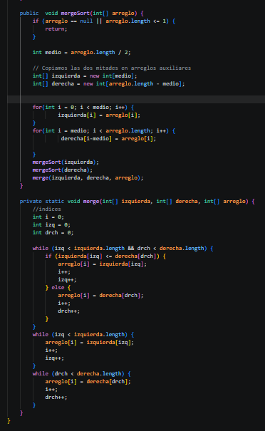

# Investigacion MergeSort

## Explicacion del algoritmo
Merge sort es un algoritmo que aplica el proceso de **divide y vencerás**
1. **Divide: ** El algoritmo empieza por dividir el arreglo, lista en dos mitades creando sublstas. Este proceso lo repite n veces hasta cada sublista contenga un solo elemento.
2. **Vencera: ** Luego el algoritmo  vuelve a unir las sublistas, pero sin antes colocar los valores de menor primero de cada sublista.

Este proceso de dividir y fusionar se realiza por medio de recursividad (llamar al mismo metodo varias veces).

## Identificacion
|Aspecto | Detalle |
|========|---------|
|Algoritmo | Merge Sort |
| Variante | Clasica de arriba hacia abajo , copia el arreglo original en dos hasta llegar a una      subarreglo de un elemento y luego fusiona los subarreglos, ordenandolos de menor a mayor.|
| Clase	 | MetodosSort |
| Ruta | src/MetodosSort.java |
| Métodos |	public voi mergeSort(int[] arreglo) y public static void merge(int[] izquierda, int[] derecha, int[] arreglo) |

## Explicacion del codigo
**Codigo: ** 

### Metodos
-mergeSort(int[] arreglo): es la parte del metodo que divide el arreglo
-merge(izquierda, derecha, arreglo): al estar los dos arreglos ya ordenados, en esta parte el metodo se fusionan para crear el arreglo ordenado

Nota: Al usar una condicional,  si el arreglo es null o tiene 0 o 1 elemento, se termina sin hacer nada, porque un arreglo de tamaño 0 o 1 ya está ordenado.

Pasos de mergeSort para n ≥ 2

Calcular medio = n / 2 (división entera).
Crear arreglo de izquierda con medio elementos y derecha con n - medio elementos.
Copiar arreglo[0..medio-1] a izquierda y arreglo[medio..n-1] a derecha.
Llamar recursivamente a mergeSort(izquierda) y mergeSort(derecha).
Llamar a merge(izquierda, derecha, arreglo), que sobrescribe arreglo con la unión ordenada.

Progreso de la recursión: en cada llamada el tamaño pasa de n a ⌊n/2⌋ y ⌈n/2⌉. Como n ≥ 2, ambos son estrictamente menores que n, así que la recursión siempre llega  y termina de manera normal. De ahi la complejidad log en base 2 de n veces.

## División, mezcla, arreglo auxiliar y empates
División: en medio = n / 2. La izquierda recibe ⌊n/2⌋ elementos y la derecha ⌈n/2⌉.
Mezcla: merge mantiene tres índices (izq, drch e i). Mientras queden elementos en ambas mitades, copia al arreglo destino el menor de los dos candidatos. Cuando una mitad se agota, copia el resto de la otra, que ya está ordenado.
Arreglo auxiliar: en esta implementación los auxiliares son izquierda y derecha, que se crean con new en cada llamada recursiva. No hay un único buffer reutilizable (a diferencia de la versión de Sedgewick y Wayne [1][2], que reserva uno solo). Esa reserva ocurre dentro de mergeSort, así que forma parte del tiempo medido de V2.
Empates: se usa izquierda[izq] <= derecha[drch]. Si los dos valores son iguales, se toma el de la izquierda, que en el arreglo original estaba antes. Eso conserva el orden relativo de los iguales (estabilidad, sección 5).

## Complejidad, memoria y estabilidad
Tiempo

Cada llamada hace trabajo proporcional a n (copiar las mitades y fusionarlas) más dos llamadas sobre n/2:

T(n) = 2·T(n/2) + Θ(n)  ⇒  T(n) = Θ(n log n)

Caso Tiempo	Justificación
- Mejor caso:	Θ(n log n).	
Siempre se divide, se copia y se recorre cada nivel, aunque el arreglo ya esté ordenado. En ese caso solo bajan las comparaciones (≈ ½·n·log₂ n [2]), no el recorrido.
- Caso Promedio:	Θ(n log n).	
Supuestos: datos aleatorios con distribución uniforme, comparar y copiar un int cuesta tiempo constante, y se ignoran los efectos de caché y de la JVM.
- Peor caso:	Θ(n log n.)
Las comparaciones suben a ≈ n·log₂ n − n + 1. El peor caso de una fusión ocurre cuando los dos mayores elementos están en mitades distintas [2].

## Estabilidad

La implementación es estable:

Las mitades se copian respetando el orden del arreglo original.
Ante un empate, merge usa <= y toma primero el elemento de la izquierda, que estaba antes en el original.
Los elementos de una misma mitad nunca se reordenan entre sí, porque se leen de izquierda a derecha.

Si se cambiara <= por <, los empates tomarían primero el de la derecha y el algoritmo dejaría de ser estable