# PL1.1 - Comparativa de algoritmos de ordenamiento y benchmark

## Datos generales
- **Autor:** David Baroja
- **Asignatura:** Estructura de Datos
- **Práctica:** PL1.1 Analisis Algoritmos de Ordenamiento
- **Ultima Fecha Modificacion:** 22/11/2026

## Entorno
- **Versión del JDK:** 25.0.4.1 
- **Sistema Operativo:** Windows 11 amd64
- **Procesador:** Intel(R) Core(TM) i5-1035G4 CPU 1.10GHz, 8 nucleos.
- **Memoria Ram:** 12gb

## Objetivo
- Lograr implementar los metodos para generar listas/arreglos con datos [int] aleatorios, asi como el uso de `System.nanoTime()` para aproximar la duracion de ejecucion de algoritmos de ordenamiento dentro de un entorno especifico.

# Comandos de copliacion y ejecucion
Desde el IDE:
1. Entrar a [Visual Studio] -> abrir carpeta proyecto
2. Seleccionar la carpeta `src/`
3. Ejecutar archivo `App.java`

## Estructura del Proyecto
```
icc-est-u1-comparativa/
- .vscode/
- bin/
- evidencias/
- src/
    - App.java
    - Benchmark.java
    - Generador.java
    - MetodosSort.java
    - Results.java
- .gitingore
- Investigacion.md
- README.md
```
## Responsabilidades de las clases y flujo datos

| Clase | Explicacion |
|-------|-------------|
|`Generador.java`| Genera arreglo de n numeros de tipo entero [int] entre el 0 y n cantidad elegida por 
 el usuario. Si n=0 genera arreglo vacio y si n<0 genera igual un arreglo vacio |
|`Benchmark.java`| tiene metodo que usa System.nanoTime() para medir el tiempo de ejecucion de cualquier 
 variable de tipo Runnable |
|`MetodosSort.java`| Los metodos de ordenamiento BubbleSort(V1) y MergeSort(V2) estan implementados |
|`Results.java`| es el modelo de la interfaz para observar los resultados | 
|`App.java`| aqui se ejectuan e imprime la lista de los resultados |

El fujo de ejecucion es: Se genera un arreglo con n datos `Generador`, luego se crea una copia `.clone()`
Se usa `Benchmark.medir(Runnable)` para medir y ejectuar el metodo de ordenamiento. Este devuelve `Results` y se imprime la lista.

## Resultados

| Sample | Metodo | Tiempo en milisegundos | Resultado obtenido | 
|--------|--------|------------------------|--------------------|
| 10 000 | V1 BubbleSort | 124.8854ms | 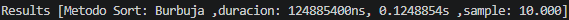 | 
| 50 000 | V1 Bubble Sort | 5023.3628ms | 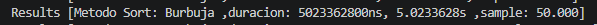  | 
| 100 000 | V1 BubbleSort | 22644.6220ms | 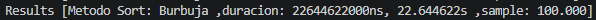 |
| 10 000 | V2 MergeSort | 4.8806ms  | 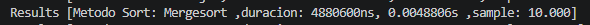 |  
| 50 000 | V2 MergeSort | 21.0285ms | 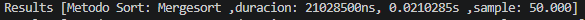 | 
| 100 000 | V2 MergeSort | 41.8277ms | 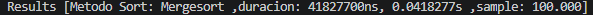 | 
| 10 000 | V3 Arrays.sort | 16.0134ms  | 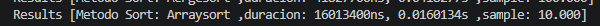 |  
| 50 000 | V3 Arrays.sort | 9.9728ms | 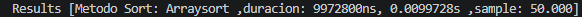 | 
| 100 000 | V3 Arrays.sort | 23.3915ms |  | 
| 10 000 | V4 Arrays.sort(Integer[], Comparator) | 15.9543ms | 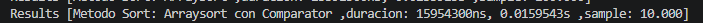 | 
| 50 000 | V4 Arrays.sort(Integer[], Comparator) | 45.9584ms | 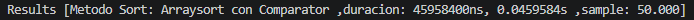 |
| 100 000 | V4 Arrays.sort(Integer[], Comparator) | 155.0701ms | 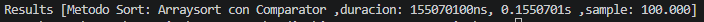 | 

**Tabla completa de los 12 Resultados:** 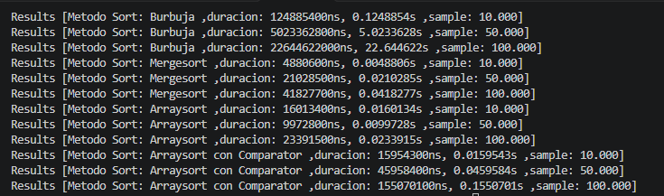

## Conclusiones
- Podemos concluir que la duracion de ejecucion utilizando cualquier metodo de ordenamiento sera directamente proporcional al numero de datos (n) del arreglo/lista en cuestion. Ademas, se pudo demostrar que algoritmos directos(avanzados) como el MergeSort tienen un tiempo de duracion mucho mas bajo con mayor cantidad de datos, comparado com algoritmos directos como BubbleSort. El tiempo de duracion de bubblesort con un arreglo de 100 000 es 5 veces mayor que Mergesort.
- El metodo utilizado System.nanoTime() para el benchmarking tiene una limitacion a mencionar. Y es que depende del entorno de donde se ejecutara el codigo. Por conecuencia, este metodo no permite afirmar con completa certeza si un algoritmo/metodo es mas rapido que otro.
- A partir de los 50 000 elementos, V4 (Integer[]) fue mucho más lento que V3 (int[]). Fue 4 veces mas lento con 50 000 (n) (45.96 ms frente a 9.97 ms) y 6 veces mas lento con 100 000 (n) (155.07 ms frente a 23.39 ms). Una explicación probable es que `Integer[]` guarda referencias a objetos en lugar de datos primitivos , lo que resulta en más memoria, acceso indirecto a cada dato y una llamada al comparador en cada comparación. Además, la biblioteca usa un algoritmo distinto para objetos que para primitivos. Por lo tanto, la velocidad de ejecucion se ve afectada por varios factores de los tipos de datos y allgoritmos (metodos) utilizados dentro de las interfaces.